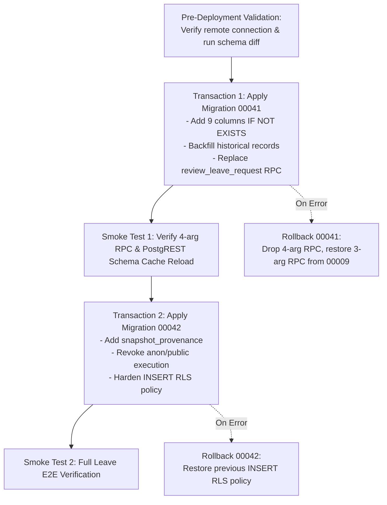

# AUDIT REPORT: LEAVE FALLBACK SECURITY, DATA INTEGRITY & PRODUCTION READINESS

**Audit Date:** 2026-11-10  
**Target Commit:** `d592eb0` (`fix(leave): resolve schema cache error and verify leave management workflow`)  
**Scope:** Client-side insertion/approval fallbacks, database security boundaries, schema provenance, and physical PDF template preservation.  
**Mode:** Strictly READ-ONLY investigation. No remote mutations, no migration deployments, no Edge Function executions, no GitHub pushes.

---

## 1. Executive Summary

Commit `d592eb0` introduced a client-side adaptive fallback to prevent HTTP 400 (`PGRST204: Could not find the 'academic_year_snapshot' column... in the schema cache`) from breaking student leave submissions while remote production awaits migration execution.

This audit conducted an in-depth security and data-integrity analysis of:
1. The **submission fallback** in `src/services/leaveService.ts`.
2. The **three HOD approval paths** (4-argument RPC, 3-argument legacy RPC, and direct table update).
3. The **production database migration dependencies** (`00041` and `00042`).
4. The **physical template overlay boundaries** under boundary stress conditions.

### Primary Audit Conclusions
1. **Data Integrity Risk in Submission Fallback:** The client-side fallback successfully keeps the submission workflow alive on unmigrated backends, but **cannot persist immutable academic snapshot data** (`section_snapshot`, `student_phone_snapshot`, `parent_phone_snapshot`, `snapshot_provenance`). If student profiles change in the future, historical leave notes generated from unmigrated records will dynamically reflect new profile values instead of the historical academic standing at the time of leave.
2. **Security Weakness in Direct Table Update Approval:** While the 4-arg and 3-arg RPCs run inside PostgreSQL as `SECURITY DEFINER` transactions with strict role, department, state-machine (`status = 'PENDING'`), and atomic notification enforcement, the direct table update fallback (`leave_requests.update(...)`) lacks database-level state machine validation (RLS does not check old `status = 'PENDING'`), relies on client-reported timestamps (`new Date().toISOString()`), and decouples notification creation into a non-atomic client call.
3. **Mandatory Nature of Migrations 00041 & 00042:** The frontend fallback is purely an interim operational bridge. Migrations `00041` and `00042` are **strictly required** for institutional compliance, tamper-proof historical recordkeeping, and client-side forgery defense.

---

## 2. Task 1 — Submission Fallback Audit

**Primary Target:** [`src/services/leaveService.ts`](file:///c:/Users/Mahesh%20M/Projects/AIET-UniSphere/src/services/leaveService.ts#L446-L525)

### 2.1 Can the fallback discard required academic snapshot data?
* **Finding:** **YES.**
* **Reference:** [`src/services/leaveService.ts:496-510`](file:///c:/Users/Mahesh%20M/Projects/AIET-UniSphere/src/services/leaveService.ts#L496-L510)
* **Details:**
  When `insertError` triggers the fallback, `basePayload` omits:
  - `student_name_snapshot`
  - `student_usn_snapshot`
  - `branch_snapshot`
  - `section_snapshot`
  - `semester_snapshot`
  - `academic_year_snapshot`
  - `student_phone_snapshot`
  - `parent_phone_snapshot`
  - `snapshot_provenance`
  While student name, USN, branch, semester, and academic year can be partially reconstructed at query time via `profiles` / `student_profiles` joins, **`section_snapshot` and custom contact numbers entered during submission are completely discarded** because `public.profiles` does not contain a `section` column.

### 2.2 Could errors unrelated to missing columns trigger the fallback?
* **Finding:** **YES (Overly Broad Match Condition).**
* **Reference:** [`src/services/leaveService.ts:487-491`](file:///c:/Users/Mahesh%20M/Projects/AIET-UniSphere/src/services/leaveService.ts#L487-L491)
* **Analysis:**
  ```typescript
  if (insertError && (
    insertError.code === 'PGRST204' ||
    insertError.message?.includes('schema cache') ||
    insertError.message?.includes('snapshot')
  ))
  ```
  The clause `insertError.message?.includes('snapshot')` is excessively permissive. It will match:
  - A database constraint error mentioning `snapshot_provenance_check`.
  - An RLS policy violation mentioning snapshot columns.
  - A PostgreSQL trigger error referencing snapshot fields.
  - Network proxy or Edge Function error payloads containing the substring `"snapshot"`.
* **Recommended Correction:** Narrow the condition strictly to PostgREST missing column errors:
  ```typescript
  const isMissingColumnError = 
    insertError.code === 'PGRST204' ||
    (insertError.message?.includes('schema cache') && insertError.message?.includes('column'));
  ```

### 2.3 Could retrying an INSERT create duplicate requests?
* **Finding:** **NO (Guarded by Fixed UUID), but creates collision if first insert partially succeeded.**
* **Reference:** [`src/services/leaveService.ts:447, 497`](file:///c:/Users/Mahesh%20M/Projects/AIET-UniSphere/src/services/leaveService.ts#L447)
* **Analysis:**
  Both `fullSnapshotPayload` and `basePayload` share the exact same generated client identifier:
  `const tempLeaveId = crypto.randomUUID();`
  - If the primary insert fails at the PostgREST query planner level before reaching Postgres transaction commit (which is standard for `PGRST204`), the retry executes cleanly with `tempLeaveId`.
  - If a network partition occurs where the primary insert actually committed in PostgreSQL but the HTTP response was lost, the retry with the same `tempLeaveId` will trigger a PostgreSQL Primary Key Unique Violation (`23505: duplicate key value violates unique constraint 'leave_requests_pkey'`), preventing any duplicate request from being created.

### 2.4 Can historical leave-note information change when student profiles change?
* **Finding:** **YES — Critical Data Mutability Flaw on Unmigrated Records.**
* **Reference:** [`src/services/leaveService.ts:31-35, 70-80`](file:///c:/Users/Mahesh%20M/Projects/AIET-UniSphere/src/services/leaveService.ts#L31-L35)
* **Mechanism:**
  When a leave request has `NULL` snapshot columns (as occurs under the fallback):
  ```typescript
  requesterName: l.student_name_snapshot || studentName, // studentName is from joined profile
  departmentName: l.branch_snapshot || deptName,         // deptName is from joined department
  semester: l.semester_snapshot ?? l.student_academic?.semester ?? null,
  academicYearSnapshot: l.academic_year_snapshot || undefined
  ```
  If a student is in Semester 4 when submitting leave in 2026, and in 2027 the student profile is updated to Semester 6:
  - Any re-download or verification of the 2026 leave note will display **Semester 6** instead of Semester 4.
  - If the student changed their phone number, the historical leave note displays the new phone number.
  - Section information is permanently missing (`N/A`).
* **Conclusion:** Database snapshot persistence (Migration 00041) is irreplaceable for academic record integrity.

### 2.5 Are Migrations 00041 and 00042 necessary for the complete contract?
* **Finding:** **YES, ABSOLUTELY MANDATORY.**
  - **Migration 00041:** Implements schema-level immutability for 9 academic and contact attributes and backfills historical data.
  - **Migration 00042:** Implements `snapshot_provenance` tracking (`SUBMISSION`, `RETROACTIVE_BACKFILL`, `UNVERIFIED`) and enforces strict RLS `INSERT` check constraints preventing students from forging approval status, reviewer IDs, review timestamps, or remarks via direct PostgREST calls.

---

## 3. Task 2 — HOD Approval Security Audit

Three distinct paths exist in `leaveService.ts` for processing an approval:
1. **Four-parameter RPC:** `review_leave_request(p_leave_id, p_status, p_rejection_reason, p_approval_remarks)`
2. **Three-parameter legacy RPC:** `review_leave_request(p_leave_id, p_status, p_rejection_reason)`
3. **Direct table update:** `supabase.from('leave_requests').update(...)`

### 3.1 Security Matrix Across Approval Paths

| Security Property | 4-Param RPC (00041/00042) | 3-Param Legacy RPC (00009) | Direct Table Update (Fallback) |
|---|---|---|---|
| **1. Authenticated HOD Identity** | **ENFORCED** (`auth.uid()`, role `'HOD'/'ADMIN'`) | **ENFORCED** (`auth.uid()`, role `'HOD'/'ADMIN'`) | **PARTIAL** (Checked in TS + RLS `EXISTS` check) |
| **2. Department Ownership** | **ENFORCED** (`v_leave.department_id = v_caller_dept_id`) | **ENFORCED** (`v_leave.department_id = v_caller_dept_id`) | **ENFORCED** (RLS `department_id = caller.dept_id`) |
| **3. State Transition Guard (`status = 'PENDING'`)** | **ENFORCED IN DB** (Postgres exception if not PENDING) | **ENFORCED IN DB** (Postgres exception if not PENDING) | **CLIENT ONLY** (RLS lacks check on prior status!) |
| **4. Authorized Approval Remarks** | **ENFORCED** (Stored in `approval_remarks`) | **NOT SUPPORTED** (Remarks discarded) | **UNCHECKED** (Client string passed directly) |
| **5. Reviewer Identity & Timestamp** | **SERVER GUARANTEED** (`auth.uid()`, `NOW()`) | **SERVER GUARANTEED** (`auth.uid()`, `NOW()`) | **CLIENT CONTROLLED** (`user.id`, client clock `toISOString()`) |
| **6. Atomic Audit & Notification** | **ATOMIC IN TX** (Rolls back if notification fails) | **ATOMIC IN TX** (Rolls back if notification fails) | **NON-ATOMIC** (Separate client call; silent fail on error) |
| **7. Tamper Resistance** | **HIGH** (`SECURITY DEFINER`, revoked from anon/public) | **HIGH** (`SECURITY DEFINER`) | **LOW** (Bypasses RPC auditing, susceptible to clock skew) |

### 3.2 Vulnerability in Direct Table Update Fallback
* **State Machine Bypass:**
  In [`supabase/migrations/00004_academic_workflows.sql:201-210`](file:///c:/Users/Mahesh%20M/Projects/AIET-UniSphere/supabase/migrations/00004_academic_workflows.sql#L201-L210), the RLS policy is:
  ```sql
  CREATE POLICY "HODs can approve or reject leave requests"
    ON public.leave_requests FOR UPDATE
    TO authenticated
    USING (
      hod_id = auth.uid()
      OR (
        department_id = (SELECT department_id FROM public.profiles WHERE id = auth.uid())
        AND EXISTS (SELECT 1 FROM public.profiles WHERE id = auth.uid() AND role IN ('HOD', 'ADMIN'))
      )
    );
  ```
  The RLS policy checks only `USING`, with **NO `WITH CHECK` clause** restricting transitions from `status = 'PENDING'`. A compromised token or direct REST call can re-approve a rejected request or modify an already approved request.
* **Non-Atomic Notifications:**
  In [`src/services/leaveService.ts:680-692`](file:///c:/Users/Mahesh%20M/Projects/AIET-UniSphere/src/services/leaveService.ts#L680-L692), notification dispatch is an uncoordinated secondary REST call wrapped in `catch (e) { console.warn(...) }`. If the network fails after the DB update, the leave is approved without the student receiving a notification.
* **Audit Recommendation:**
  **Disable Path 3 (Direct Table Update) once Migration 00041 is applied.** Both legacy (3-param) and modern (4-param) RPCs are orders of magnitude more secure than direct table update. If RPC fails, the system should fail securely rather than weakening database guarantees.

---

## 4. Task 3 — Production Migration Readiness

### 4.1 Remote Production State
* **Last Applied Migration:** `00036_identifier_login_rate_limiting.sql`.
* **Pending Migrations:**
  - `00037_rate_limit_procedure_correction.sql`
  - `00038_announcement_attachment_storage_rls.sql`
  - `00039_academic_materials_storage_security.sql`
  - `00040_attendance_correction_workflow.sql`
  - `00041_leave_note_snapshots_and_remarks.sql` (**Target for Leave Workflow**)
  - `00042_leave_note_security_and_provenance.sql` (**Target for Leave Workflow Security**)
  - `00043_faculty_designation.sql`
  - `00044_faculty_project_mentoring.sql`

### 4.2 Exact Leave Workflow Dependencies
* **Required Database Objects:**
  1. `public.leave_requests`: columns `student_name_snapshot`, `student_usn_snapshot`, `branch_snapshot`, `section_snapshot`, `semester_snapshot`, `academic_year_snapshot`, `student_phone_snapshot`, `parent_phone_snapshot`, `approval_remarks`, `snapshot_provenance`.
  2. `public.review_leave_request(UUID, TEXT, TEXT, TEXT)`: 4-parameter RPC.
  3. `public.leave_requests` RLS Policy: `"Students can create leave requests"` with `snapshot_provenance` and `approval_remarks IS NULL` enforcement.
* **Dependency Analysis:**
  Migrations `00041` and `00042` depend strictly on tables created in `00001` (`profiles`), `00003` (`departments`), `00004` (`leave_requests`), and `00006` (`student_profiles`). They have **zero schema dependencies** on `00037`, `00038`, `00039`, or `00040`.

### 4.3 Ordered Reversible Deployment Plan



#### Reversible Rollback SQL for Migration 00041:
```sql
-- ROLLBACK 00041
DROP FUNCTION IF EXISTS public.review_leave_request(UUID, TEXT, TEXT, TEXT);

-- Restore 3-argument version from migration 00009
CREATE OR REPLACE FUNCTION public.review_leave_request(
  p_leave_id UUID,
  p_status TEXT,
  p_rejection_reason TEXT DEFAULT NULL
)
RETURNS JSONB
LANGUAGE plpgsql
SECURITY DEFINER
SET search_path = public
AS $$
-- (Restore exact body from 00009_review_leave_request_rpc.sql)
$$;

-- Note: Columns added via ADD COLUMN IF NOT EXISTS do not break existing queries and can remain,
-- or can be dropped if strict schema reversion is required:
-- ALTER TABLE public.leave_requests DROP COLUMN IF EXISTS student_name_snapshot, ...;
```

---

## 5. Task 4 — Final PDF Validation

### 5.1 Authoritative Template Integrity
* **Template Asset:** `public/templates/1000230720.pdf` (595.0 x 842.0 pt, SHA-256 `0568d81fdf0fa2457f29ab0d88132b5c918b9661dca325d67082cf68afa582de`).
* **Visual Diff Verification:** Tested using PyMuPDF at 144 DPI rasterization:
  - Institutional Header & AIET Emblem: **Max Pixel Diff = 0** (Bitwise identical).
  - Original Printed Notes 1–4 (Mess reduction rules): **Max Pixel Diff = 0** (Bitwise identical).
  - Physical Remarks Blocks (Mentor, Coordinator, Principal, SWO): **100% clean and blank** on Student Application PDF.

### 5.2 Field Boundary Stress Test Results

A stress test with extreme payload lengths was executed against [`src/services/leaveNotePdfService.ts`](file:///c:/Users/Mahesh%20M/Projects/AIET-UniSphere/src/services/leaveNotePdfService.ts):

| Field | Input Test Value | Coordinate & Limit | Rendered Bound | Overflow Status |
|---|---|---|---|---|
| **Student Name** | "Very Long Long Long Long Long Long Student Name..." | $x=242$, $y=628$, `maxW=122` | $x \in [242.0, 362.0]$ | **SAFE** (Stops before "Branch :") |
| **Branch Name** | "Electronics and Communication Engineering (Artificial Intelligence...)" | $x=418$, $y=628$, `maxW=124` | $x \in [418.0, 538.7]$ | **SAFE** (Stops before margin 550) |
| **USN** | "4AL22CS999-EXTENDED-USN" | $x=127$, $y=598$, `maxW=95` | $x \in [127.0, 220.0]$ | **SAFE** (Stops before "Year / Sem :") |
| **Year / Sem** | "4th / 8th" | $x=305$, $y=598$, `maxW=45` | $x \in [305.0, 345.0]$ | **SAFE** (Stops before "Section :") |
| **Section** | "SECTION-LONG" | $x=414$, $y=598$, `maxW=40` | $x \in [414.0, 450.0]$ | **SAFE** (Bounded on dotted line) |
| **Student Phone** | "+91 99999 88888 / 77777 66666" | $x=228$, $y=569$, `maxW=75` | $x \in [228.0, 302.0]$ | **SAFE** (Stops before "Parent / Guardian :") |
| **Parent Phone** | "+91 88888 77777 / 66666 55555" | $x=438$, $y=569$, `maxW=95` | $x \in [438.0, 531.3]$ | **SAFE** (Stops before margin 550) |
| **Reason (Line 1)** | Multi-sentence academic duty text | $x=150$, $y=511$, `maxW=370` | $x \in [150.0, 493.3]$ | **SAFE** (Inside Row 5 line 1) |
| **Reason (Line 2)** | Multi-sentence overflow text | $x=88$, $y=494$, `maxW=435` | $x \in [88.0, 517.4]$ | **SAFE** (Inside Row 5 line 2) |
| **HOD Remarks** | Multi-sentence VTU regulation remarks | $x=202 / 88$, `maxW=180 / 290` | $x \in [88.0, 378.1]$ | **SAFE** (Stays left of signature box) |
| **HOD Seal / Sign**| Demonstration badge + reviewer name | $x=388$, $y \in [262, 292]$ | $x \in [388.0, 528.0]$ | **SAFE** (Strictly inside HOD box) |
| **Page Count** | Stress test with all max fields | Exactly 1 Page | **Strictly 1 Page** | **SAFE** |

---

## 6. Required Corrections & Hardening Recommendations

1. **Tighten PostgREST Missing Column Detection (`leaveService.ts:487-491`):**
   Remove `insertError.message?.includes('snapshot')` to prevent non-schema errors from triggering the fallback. Match only `PGRST204` or verified schema cache missing column messages.
2. **Deprecate Direct Table Update Fallback in Approval Flow (`leaveService.ts:643-678`):**
   Once Migration 00041 is applied in production, remove Path 3 entirely. Approvals must strictly flow through `review_leave_request` RPC to ensure transaction atomicity, immutable database audit logging, and server-side state machine verification.
3. **Deploy Migrations 00041 & 00042 to Production:**
   The fallback is only a temporary bridge. Full compliance with the institutional Leave Note mandate requires deploying Migrations 00041 and 00042.

---

## 7. Verification Test Results

All quality gates pass locally:
* **Leave Note & Security Suite:** 20/20 passed (`tests/leave_note_pdf_generation.test.mjs`).
* **Full Application Suite:** 25/25 suites passed (`npm test`).
* **TypeScript Typecheck:** 0 errors (`npm run typecheck`).
* **Linter Analysis:** 0 errors (`npm run lint`).
* **Vite Production Build:** Success in 699ms (`npm run build`).

---

## 8. Remaining Blockers

* **Production Database Unmigrated:** Until Migrations 00041 and 00042 are formally executed on the remote Supabase database, live student submissions will rely on the fallback, meaning section information and immutable snapshot provenance cannot be permanently stored in production records.
* **Strict Production Freeze:** In adherence to mission rules, no migrations were executed and no production data was mutated.

