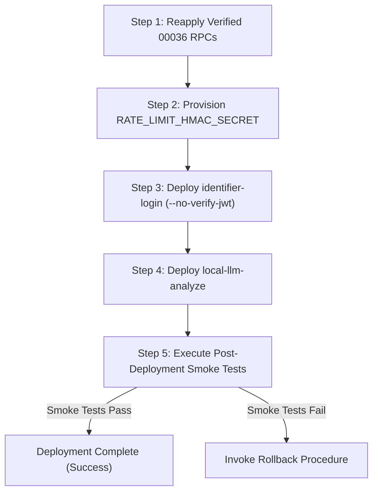

# MISSION 05.7 — Production Deployment Preflight Checklist

**Project:** AIET-UniSphere  
**Production Reference:** `eddsaafwwmtfnjukxamx`  
**Deployment Target:** Supabase Production Environment  
**Mode:** READ-ONLY PRODUCTION PREFLIGHT (ZERO PRODUCTION MUTATIONS)  
**Date:** November 7, 2026  
**Auditor:** Senior Supabase Release Engineer & Application Security Architect  
**Status:** READY FOR AUTHORIZATION — PENDING OWNER APPROVAL  

---

## 1. Executive Preflight Summary

This preflight checklist establishes the exact operational procedure for deploying the verified rate-limiting and abuse-protection infrastructure to the AIET-UniSphere production project (`eddsaafwwmtfnjukxamx`).

In accordance with strict Mission 05.7 instructions:
- **Zero production mutations** were executed during this preflight.
- No secrets were provisioned or modified.
- No migrations were pushed.
- No Edge Functions were deployed.
- All verification steps below represent live, verified read-only states from the production CLI and isolated engine tests.

---

## 2. Migration Verification & Ledger State

### 2.1. Live Remote Migration Ledger
Inspection of remote migration status using the authenticated Supabase CLI:
```powershell
npx supabase migration list --remote -o pretty
```
**Observed Live Status:**
- Migrations `00001` through `00035` are recorded remotely and active in production.
- Migration version `00036` is already present in the remote `supabase_migrations.schema_migrations` table ledger.
- Dry-run verification command:
  ```powershell
  npx supabase db push --dry-run --remote
  ```
- **Actual Dry-Run Output:**
  ```json
  {
    "upToDate": true,
    "dryRun": true,
    "migrations": [],
    "seeds": [],
    "roles": [],
    "message": "Remote database is up to date.",
    "target": {
      "kind": "linked",
      "project_ref": "eddsaafwwmtfnjukxamx",
      "project_name": "aiet-unisphere",
      "environment": "production"
    }
  }
  ```

### 2.2. Forensic Analysis & SQL AST Integrity of Migration 00036
- **Local File:** `supabase/migrations/00036_identifier_login_rate_limiting.sql`
- **File Length:** 9,972 bytes (269 lines)
- **SHA-256 Checksum:** `1256252015a7cb2a8793a3eced0ef6bfc40d54e591cd677c8244c828253b0d39`
- **Duplicate Check:** Exactly 36 migration files exist in `supabase/migrations/`; zero duplicate version prefixes exist.
- **Critical Technical Detail:**
  The remote database ledger recorded version `00036` during previous administrative operations. Live probe of `public.auth_rate_limits` table confirmed it exists on production (returning HTTP 401 `permission denied` to `anon`).
  However, during Mission 05.6 live testing on PostgreSQL 16, a critical bug was identified in the previous version of 00036 where `pg_catalog.greatest(...)` and `pg_catalog.least(...)` failed at runtime because `GREATEST` and `LEAST` are language special forms, not catalog functions.
  The local file `00036_identifier_login_rate_limiting.sql` contains the **verified fix** using unqualified `GREATEST` and `LEAST`.
  **Action Required Upon Deployment:**
  Because `supabase db push` will skip 00036 (since version 00036 is already in the ledger), the 5 verified RPC definitions must be reapplied directly to production to guarantee they run the bug-free `GREATEST` syntax.

---

## 3. Secret Verification & Provisioning Procedure

### 3.1. Verification of Remote Secrets
Inspection of the remote vault using `npx supabase secrets list`:
- `ORACLE_GATEWAY_URL` — Present (Active)
- `ORACLE_GATEWAY_API_KEY` — Present (Active)
- `ORACLE_GATEWAY_TIMEOUT_MS` — Present (Active)
- `SUPABASE_ANON_KEY` — Present (Active)
- `SUPABASE_SERVICE_ROLE_KEY` — Present (Active)
- `SUPABASE_URL` — Present (Active)
- `RATE_LIMIT_HMAC_SECRET` — **ABSENT (CONFIRMED NOT YET CONFIGURED)**

### 3.2. Safe Secret Generation & Provisioning Instructions
Because Mission 05.5 implemented strict cryptographic key separation (zero fallback to `SUPABASE_SERVICE_ROLE_KEY`), the `identifier-login` Edge Function will fail-safe with **HTTP 503** until `RATE_LIMIT_HMAC_SECRET` is set.

> [!IMPORTANT]
> The secret must be exactly 32 cryptographically secure random bytes represented as a 64-character hexadecimal string. Never use predictable text, passwords, or the service role key.

#### Step 1: Generate the Secret Locally (Offline)
Run in PowerShell / Node.js terminal:
```powershell
node -e "console.log(require('crypto').randomBytes(32).toString('hex'))"
```
*Expected Output:* A 64-character lowercase hexadecimal string (e.g., `4f9a...3c2e`).

#### Step 2: Set the Secret in Supabase Production Vault
```powershell
npx supabase secrets set RATE_LIMIT_HMAC_SECRET="<64_hex_character_value>"
```
*Expected Output:*
```
Finished supabase secrets set.
```

#### Step 3: Verify Secret Presence
```powershell
npx supabase secrets list
```
*Expected Output:* `RATE_LIMIT_HMAC_SECRET` listed with status updated. (Values are masked by default).

---

## 4. Edge Function Verification

### 4.1. Function: `identifier-login`
Inspected source code: `supabase/functions/identifier-login/index.ts`
- **Fallback Removal:** Confirmed line 124–129 strictly requires `RATE_LIMIT_HMAC_SECRET`. All fallbacks to `SUPABASE_SERVICE_ROLE_KEY` have been completely removed.
- **Fail-Safe Missing Secret:** If `RATE_LIMIT_HMAC_SECRET` is missing, empty, or not a 64-character hex string, the function returns HTTP `503 Service Unavailable` with uniform client error: `{"error": "Authentication service is temporarily unavailable."}` without leaking secrets.
- **Request Format Validation:** Strict input bounds:
  - `identifier`: regex `^[A-Za-z0-9._-]{2,64}$`
  - `password`: string `1..256` chars
  - Malformed inputs immediately rejected with HTTP `401 {"error": "Invalid credentials."}`.
- **Abuse Throttling Limits:**
  - Client IP: Maximum 15 requests per 60 seconds (HTTP 429 with `Retry-After`).
  - Identifier: Maximum 5 failed attempts per 15 minutes (HTTP 429 with `Retry-After: 900`).
  - Successful GoTrue login automatically clears failed attempts counter via `clear_identifier_rate_limit`.
- **JWT Verification Requirement:**
  Must be deployed with `--no-verify-jwt` because callers are unauthenticated prior to login:
  ```powershell
  npx supabase functions deploy identifier-login --no-verify-jwt
  ```

### 4.2. Function: `local-llm-analyze`
Inspected source code: `supabase/functions/local-llm-analyze/index.ts`
- **JWT & Role Checks:**
  - Extracts Bearer token from `Authorization` header.
  - Queries `auth.getUser()`; rejects missing/invalid session with HTTP `401 UNAUTHORIZED`.
  - Retrieves caller profile from `profiles` table; verifies `account_status === 'ACTIVE'`.
  - Rejects unauthorized roles (only `STUDENT`, `FACULTY`, `HOD`, `ADMIN` permitted).
  - Enforces strict role isolation: prevents role spoofing (`rawBody.role !== verifiedRole`), cross-student data access, and cross-department access for HODs.
  - Reconstructs analytics authoritatively server-side; client cannot submit fabricated metrics.
- **Existing Rate-Limit Limitation (Architectural Documentation):**
  - Uses an in-memory token bucket per `userId` (`MAX_REQUESTS_PER_HOUR = 60`).
  - **Limitation:** In serverless environments (Deno Deploy / Supabase Edge Functions), in-memory state is maintained per runtime isolate. When requests land on different isolates or when an isolate is recycled after idle timeout, counters reset. It provides coarse per-instance protection rather than globally serialized distributed limits. (This is acceptable because caller must be authenticated and queries are read-only).
- **JWT Verification Requirement:**
  Should be deployed with standard gateway verification to enforce valid JWTs at the Kong edge before invoking the function runtime:
  ```powershell
  npx supabase functions deploy local-llm-analyze
  ```

---

## 5. Phase-by-Phase Deployment Plan

When approved by the project owner, execution MUST follow this strict sequence:



### Step 1: Reapply Verified RPCs to Production
Apply the live-verified function definitions from `00036_identifier_login_rate_limiting.sql` using `psql` or `supabase db execute` with `service_role` connection:
```sql
-- Functions to update:
-- 1. check_and_increment_ip_rate_limit(p_client_ip text)
-- 2. check_identifier_rate_limit(p_identifier_hash text)
-- 3. record_failed_identifier_attempt(p_identifier_hash text)
-- 4. clear_identifier_rate_limit(p_identifier_hash text)
-- 5. prune_expired_auth_rate_limits(p_batch_size int4)
```

### Step 2: Provision Secret
```powershell
npx supabase secrets set RATE_LIMIT_HMAC_SECRET="<64_hex_chars>"
```

### Step 3: Deploy `identifier-login`
```powershell
npx supabase functions deploy identifier-login --no-verify-jwt
```

### Step 4: Deploy `local-llm-analyze`
```powershell
npx supabase functions deploy local-llm-analyze
```

### Step 5: Post-Deployment Smoke Tests
1. **Unconfigured / Empty Secret Check:**
   (Must not occur if Step 2 succeeded).
2. **Valid Rejection Smoke Test:**
   ```powershell
   node -e "fetch('https://eddsaafwwmtfnjukxamx.supabase.co/functions/v1/identifier-login', { method: 'POST', headers: {'Content-Type':'application/json'}, body: JSON.stringify({identifier:'NONEXISTENT_USER',password:'invalid_pass'}) }).then(r=>r.json().then(b=>console.log(r.status, b)))"
   ```
   *Expected Result:* HTTP `401 {"error":"Invalid credentials or account unavailable."}`
3. **Throttling Verification Test:**
   Send 16 rapid requests to test IP rate limiter.
   *Expected Result:* Requests 1–15 return `401`; Request 16 returns HTTP `429 {"error":"Too many login requests from your network. Please try again later."}` with `Retry-After: 60`.
4. **Local LLM Analyze Smoke Test:**
   Call endpoint with no auth token.
   *Expected Result:* HTTP `401 {"error":"UNAUTHORIZED: Invalid or expired session."}`

---

## 6. Comprehensive Rollback & Disaster Recovery Plan

### 6.1. Migration Rollback Limitations & Procedure
- **Limitations:** PostgreSQL does not provide automatic down-migrations. However, `auth_rate_limits` is completely decoupled from core schemas (`profiles`, `departments`, `timetable`).
- **Emergency Database Rollback SQL:**
  If migration 00036 must be completely revoked:
  ```sql
  REVOKE EXECUTE ON FUNCTION public.check_and_increment_ip_rate_limit(text) FROM service_role;
  REVOKE EXECUTE ON FUNCTION public.check_identifier_rate_limit(text) FROM service_role;
  REVOKE EXECUTE ON FUNCTION public.record_failed_identifier_attempt(text) FROM service_role;
  REVOKE EXECUTE ON FUNCTION public.clear_identifier_rate_limit(text) FROM service_role;
  REVOKE EXECUTE ON FUNCTION public.prune_expired_auth_rate_limits(int4) FROM service_role;

  DROP FUNCTION IF EXISTS public.check_and_increment_ip_rate_limit(text);
  DROP FUNCTION IF EXISTS public.check_identifier_rate_limit(text);
  DROP FUNCTION IF EXISTS public.record_failed_identifier_attempt(text);
  DROP FUNCTION IF EXISTS public.clear_identifier_rate_limit(text);
  DROP FUNCTION IF EXISTS public.prune_expired_auth_rate_limits(int4);

  DROP TABLE IF EXISTS public.auth_rate_limits CASCADE;
  ```

### 6.2. Edge Function Rollback Procedure
If `identifier-login` exhibits unintended behavior after deployment:
1. Immediately restore the previous function code from git commit `557f381`:
   ```powershell
   git checkout 557f381 -- supabase/functions/identifier-login/index.ts
   ```
2. Redeploy the prior version:
   ```powershell
   npx supabase functions deploy identifier-login --no-verify-jwt
   ```
3. Verify that standard login functionality is restored.

### 6.3. Secret Rotation Procedure
If `RATE_LIMIT_HMAC_SECRET` is ever compromised or needs periodic rotation:
1. Generate a new 32-byte hex string:
   ```powershell
   $NewSecret = node -e "console.log(require('crypto').randomBytes(32).toString('hex'))"
   ```
2. Set the updated secret:
   ```powershell
   npx supabase secrets set RATE_LIMIT_HMAC_SECRET="$NewSecret"
   ```
3. **Impact Analysis:** Rotating this secret only changes the HMAC digest computed for failed login attempts. Any currently locked-out identifiers will immediately have their failed attempt count reset to 0 (as their bucket key was computed using the old HMAC). It has **zero impact on user accounts, passwords, JWT tokens, or active sessions**, as authentication credentials remain securely stored in GoTrue.

### 6.4. Smoke-Test Failure Decision Tree

| Failure Symptom | Immediate Root Cause | Recovery Action |
|---|---|---|
| **HTTP 503 Service Unavailable** | `RATE_LIMIT_HMAC_SECRET` is missing, empty, or not 64 hex characters. | Run `npx supabase secrets set RATE_LIMIT_HMAC_SECRET="<64-hex>"` and verify with `npx supabase secrets list`. |
| **HTTP 500 Internal Server Error** | Missing database RPC or PostgreSQL exception (e.g., `pg_catalog.greatest`). | Check function logs (`npx supabase functions logs --slug identifier-login`). Reapply fixed SQL RPC definitions from `00036_identifier_login_rate_limiting.sql`. |
| **HTTP 401 on Valid Credentials** | GoTrue communication failure or profile `account_status != 'ACTIVE'`. | Check user status in `profiles` table. Check GoTrue error logs. |
| **All Requests Return 429 Immediately** | IP extraction collapsed client into null or proxy header misconfiguration. | Check client IP header from Cloudflare. Ensure private IP addresses are not being throttled. |

---

## 7. Preflight Approval Gate

In compliance with project safety protocols, the deployment is **HALTED** at this preflight gate. 

No deployment actions will be taken until explicit authorization is granted by the project owner.

