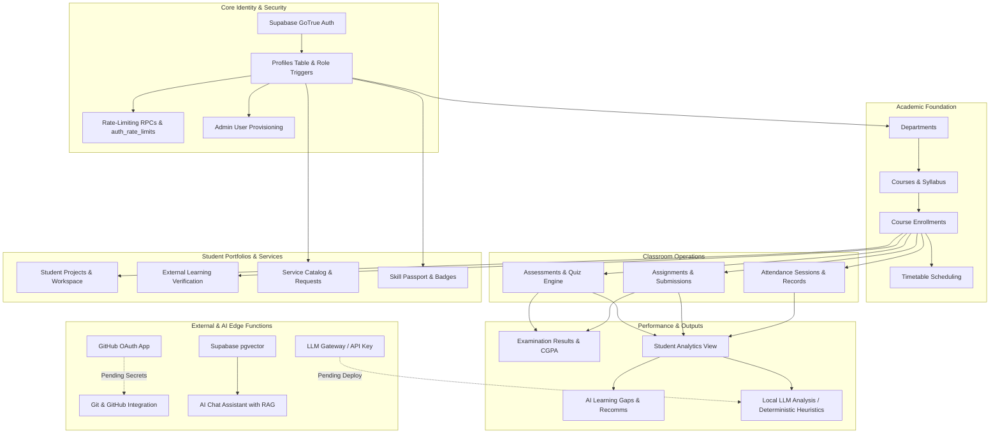

# AIET-UniSphere — Mission 06 Dashboard Functional Audit

**Document Reference:** `docs/audit/MISSION_06_DASHBOARD_FUNCTIONAL_AUDIT.md`  
**Audit Target:** Student, Faculty, HOD, and Admin Dashboards  
**Project:** AIET-UniSphere — AI-powered Smart Learning Management System  
**Supabase Production Project Ref:** `eddsaafwwmtfnjukxamx`  
**Audit Mode:** READ-ONLY CODEBASE & ARCHITECTURAL AUDIT (Zero Mutations Executed)  
**Date:** November 7, 2026  

---

## 1. Executive Summary

A comprehensive, repository-wide functional audit was conducted across all 4 major application portals: **Student Dashboard**, **Faculty Dashboard**, **HOD Dashboard**, and **Admin Dashboard**. The objective of this audit is to verify genuine end-to-end functionality, detect mock/dummy/hardcoded data, evaluate database and Edge Function connectivity, audit Row-Level Security (RLS) enforcement, and provide an actionable, prioritized roadmap for full production readiness.

### Key Audit Conclusions

1. **High Core Functional Completeness (~88% Operational):**  
   The primary academic workflows across all four portals—including course enrollment, student roster visibility, assignments, quiz assessments, timetable scheduling with advisory locking, attendance tracking, SGPA/CGPA result reporting, announcements, service requests, and admin user provisioning—are genuine, full-stack implementations backed by Supabase PostgreSQL tables, typed services, and enforced RLS policies.
2. **Mock Data Decoupling Status:**  
   Runtime mock datasets (`src/data/mock/`) have been successfully decoupled into reference directories; runtime arrays in active services are initialized empty (`[]`) and populated via Supabase clients. However, localized hardcoded strings and empty activity arrays exist in dashboard presentation layers:
   - **Student Dashboard (`src/pages/StudentDashboard.tsx` L226–229):** The `AIInsightCard` renders static sample strings ("Your recent assessment performance in Database Systems has improved...").
   - **Faculty Dashboard (`src/faculty/pages/FacultyDashboard.tsx` L232):** The Recent Activity feed binds to `stats.recentActivities: []` because the backend activity log aggregator is not yet hooked to faculty action events.
3. **External Integrations & AI Edge Functions:**
   - **GitHub Integration (`src/pages/GitGithubPage.tsx`):** Unusable in production because `VITE_GITHUB_CLIENT_ID` is absent from `.env`, and backend Edge Functions `github-oauth` and `github-api` are not deployed to production.
   - **AI Analytics & RAG Assistant:** The AI Chat Assistant (`ai-chat` Edge Function) is functional with RAG vector search (`match_document_chunks`). However, the `local-llm-analyze` Edge Function (for autonomous student performance analysis) is staged locally but not yet deployed; frontend components gracefully fall back to deterministic rule-based algorithms (`computeInsights`).
4. **Rate-Limiting & Security Baseline:**  
   The authentication rate-limiting implementation (Missions 05.1–05.9) is fully verified with 152 unit/integration tests and 10 real PostgreSQL suites passing. Migration `00037_rate_limit_procedure_correction.sql` is staged for deployment.
5. **Leave Module Exclusion:**  
   In strict compliance with **Part E**, all leave-related workflows (student leave submissions, leave history, HOD leave approval queue, leave notifications, and PDF generation) have been recorded as **`DEFERRED — OWNER'S SEPARATE DESIGN`** with zero modifications.

---

## 2. Role-Wise Feature Inventory & Classification

All features across the four dashboard portals were inspected directly in source code and classified under one of the 7 standardized categories:
- **`FUNCTIONAL`**: Verified end-to-end with real database/service integration and RLS.
- **`PARTIALLY FUNCTIONAL`**: Core operations work, but secondary actions or cloud backends fall back to deterministic mocks.
- **`MOCK DATA`**: UI relies on hardcoded or fabricated static strings/objects.
- **`UI ONLY`**: Interface elements render without functional backend dispatch.
- **`BROKEN`**: Feature fails or is unreachable in production due to missing secrets/endpoints.
- **`MISSING`**: Expected UI/UX feature or CRUD handler has no implementation.
- **`DEFERRED`**: Leave-related workflows under separate design.

---

### 2.1 Student Dashboard (`/student/*`)

| # | Feature / View | Route / Component | Primary Service | Classification | Status & Audit Notes |
|---|---|---|---|---|---|
| 1 | **Academic Overview & Stats** | `/student/dashboard`<br>`StudentDashboard.tsx` | `studentService.ts`<br>`courseEnrollmentService.ts` | **FUNCTIONAL** | Fetches profile, enrolled courses, pending assignments, attendance summaries, and overall average from Supabase. |
| 2 | **AI Insight Card** | `StudentDashboard.tsx` (L226–229) | Direct Component Prop | **MOCK DATA** | Renders hardcoded string: *"Your recent assessment performance in Database Systems has improved by 12%..."* Requires wiring to `aiService.ts`. |
| 3 | **Courses Roster & Detail** | `/student/courses`<br>`CoursesList.tsx`<br>`CourseDetail.tsx` | `courseEnrollmentService.ts`<br>`facultyCourseService.ts` | **FUNCTIONAL** | Queries `course_enrollments`, `courses`, and `course_materials`. Enrolled students can download lecture notes and view syllabus. |
| 4 | **Assignments & Submissions** | `/student/assignments`<br>`AssignmentsList.tsx`<br>`AssignmentDetail.tsx` | `assignmentService.ts` | **FUNCTIONAL** | Full submission flow with file uploads to Supabase Storage bucket `ASSIGNMENT_SUBMISSIONS`. Validates deadlines and displays grading status. |
| 5 | **Assessments & Quiz Engine** | `/student/assessments`<br>`AssessmentsList.tsx`<br>`AssessmentAttempt.tsx` | `assessmentService.ts` | **FUNCTIONAL** | Queries published assessments from `assessments` and questions from `assessment_questions`. Enforces single-attempt limits and records answers in `assessment_answers`. |
| 6 | **Attendance Tracking** | `/student/attendance`<br>`AttendanceDetail.tsx` | `studentService.ts` | **FUNCTIONAL** | Reads `attendance_records` joined with `attendance_sessions`. Computes real-time subject-wise percentage and shortage warnings (<75%). |
| 7 | **Timetable & Daily Schedule** | `/student/timetable`<br>`TimetablePage.tsx` | `departmentService.ts` | **FUNCTIONAL** | Reads `timetable_entries` filtered by student department and academic year. Subscribes to Supabase Realtime channel for live updates. |
| 8 | **Academic Calendar** | `/student/calendar`<br>`AcademicCalendarPage.tsx` | `departmentService.ts` | **FUNCTIONAL** | Reads `academic_calendar` table. Handles empty states gracefully when no college events are scheduled. |
| 9 | **Exam Results & SGPA/CGPA** | `/student/results`<br>`ResultsPage.tsx` | `studentService.ts` | **FUNCTIONAL** | Reads `results` table. Displays semester breakdowns, credits earned, letter grades, and cumulative CGPA. |
| 10 | **Announcements** | `/student/announcements`<br>`AnnouncementsPage.tsx` | `departmentService.ts` | **FUNCTIONAL** | Queries `announcements` targeting `ALL` or `STUDENTS` with department filtering. Writes read receipts to `announcement_reads`. |
| 11 | **Notifications Feed** | `/student/notifications`<br>`NotificationsPage.tsx` | `notificationService.ts` | **FUNCTIONAL** | Reads `notifications` table scoped to `auth.uid()`. Supports mark-as-read and dismiss actions. |
| 12 | **Projects & Workspace** | `/student/projects`<br>`ProjectsList.tsx`<br>`ProjectWorkspace.tsx` | `projectService.ts` | **FUNCTIONAL** | Full project management system: `user_projects`, `project_tasks`, `project_milestones`, and `project_files` with storage integration. |
| 13 | **Git & GitHub Integration** | `/student/github`<br>`GitGithubPage.tsx` | `githubService.ts` | **BROKEN** | UI is fully rendered, but `VITE_GITHUB_CLIENT_ID` is missing from environment, and Edge Functions `github-oauth` and `github-api` are not deployed to production. |
| 14 | **AI Learning Assistant** | `/student/ai-assistant`<br>`AILearningAssistantPage.tsx` | `aiService.ts` | **FUNCTIONAL** | Connected to deployed `ai-chat` Edge Function with RAG vector search against institutional curriculum documents. Enforces context isolation. |
| 15 | **Analytics & Performance** | `/student/analytics`<br>`AnalyticsPerformancePage.tsx` | `analyticsAIService.ts` | **PARTIALLY FUNCTIONAL** | Deterministic calculations (scores, attendance correlations) are 100% functional. Local LLM insight generator safely falls back to rule-based engine because `local-llm-analyze` is not deployed. |
| 16 | **Learning Gaps & Recomms** | `/student/learning-gaps`<br>`LearningGapsPage.tsx`<br>`RecommendationsPage.tsx` | `analyticsAIService.ts` | **FUNCTIONAL** | Evaluates assessment attempts and quiz scores to identify weak cognitive domains and recommends review materials. |
| 17 | **Skill Passport & Badges** | `/student/skills`<br>`SkillPassportPage.tsx`<br>`AchievementsPage.tsx` | `studentService.ts` | **FUNCTIONAL** | Reads `student_skills` and `student_achievements`. Displays verified skill tags and extracurricular badges. |
| 18 | **Service Catalog & Requests** | `/student/services`<br>`StudentServicesPage.tsx`<br>`ServiceRequestsPage.tsx` | `serviceCatalogService.ts` | **FUNCTIONAL** | Full service request workflow (bonafide certificates, ID card re-issue) backed by `service_catalog` and `student_service_requests`. |
| 19 | **External Learning Credits** | `/student/external-learning`<br>`ExternalLearningPage.tsx` | `externalLearningService.ts` | **FUNCTIONAL** | Backed by `external_learning_courses` and `external_course_evidence`. Supports certificate uploads to `STUDENT_DOCUMENTS` bucket. |
| 20 | **Leave Management** | `/student/leave`<br>`LeaveRequestsPage.tsx` | `leaveService.ts` | **DEFERRED** | **DEFERRED — OWNER'S SEPARATE DESIGN** (Excluded per Part E). |

---

### 2.2 Faculty Dashboard (`/faculty/*`)

| # | Feature / View | Route / Component | Primary Service | Classification | Status & Audit Notes |
|---|---|---|---|---|---|
| 1 | **Faculty Overview & Stats** | `/faculty/dashboard`<br>`FacultyDashboard.tsx` | `facultyService.ts` | **FUNCTIONAL** | Aggregates assigned courses count, active students, pending assignment submissions, and upcoming lecture slots. |
| 2 | **Recent Activity Feed** | `FacultyDashboard.tsx` (L232) | `facultyService.ts` | **UI ONLY** | `stats.recentActivities` returns an empty array `[]`. Activity logging table is not queried for faculty dashboard feeds. |
| 3 | **Assigned Courses Management** | `/faculty/courses`<br>`FacultyCoursesList.tsx`<br>`FacultyCourseDetail.tsx` | `facultyCourseService.ts` | **FUNCTIONAL** | CRUD operations on course syllabus, lecture materials (`course_materials`), and resource uploads scoped to `faculty_id`. |
| 4 | **Student Roster & Directory** | `/faculty/students`<br>`FacultyStudentList.tsx`<br>`FacultyStudentDetail.tsx` | `facultyService.ts` | **FUNCTIONAL** | Views students enrolled in faculty's assigned courses. Accesses academic performance metrics and individual attendance summaries. |
| 5 | **Attendance Marking System** | `/faculty/attendance`<br>`FacultyAttendancePage.tsx` | `facultyService.ts` | **FUNCTIONAL** | Creates class sessions in `attendance_sessions` and batch-records student statuses (`PRESENT`, `ABSENT`, `LATE`) in `attendance_records`. |
| 6 | **Assignment Creation & Grading** | `/faculty/assignments`<br>`FacultyAssignmentList.tsx`<br>`GradeSubmissionModal.tsx` | `assignmentService.ts` | **FUNCTIONAL** | Full creation modal with deadline, max marks, and attachment support. Grading modal updates `assignment_submissions` with marks and feedback. |
| 7 | **Assessment Authoring & Review** | `/faculty/assessments`<br>`FacultyAssessmentList.tsx`<br>`FacultyAssessmentDetail.tsx` | `assessmentService.ts` | **FUNCTIONAL** | Backed by Migration 00033 review system. Faculty can create quizzes, add questions, publish assessments, and review student attempt statistics. |
| 8 | **External Course Verification** | `/faculty/external-learning`<br>`ExternalCourseVerificationQueue.tsx` | `externalLearningService.ts` | **FUNCTIONAL** | Verification queue for student-submitted MOOC/NPTEL certificates. Supports `APPROVED` / `REJECTED` status transitions with mandatory rejection notes. |
| 9 | **Faculty Timetable Schedule** | `/faculty/timetable`<br>`FacultyTimetablePage.tsx` | `departmentService.ts` | **FUNCTIONAL** | Renders weekly teaching schedule filtered by `faculty_id = auth.uid()`. Displays room numbers, subject codes, and batch allocations. |
| 10 | **Faculty Announcements** | `/faculty/announcements`<br>`FacultyAnnouncementPage.tsx` | `departmentService.ts` | **FUNCTIONAL** | Broadcasts course or department announcements targeting enrolled students. |
| 11 | **Faculty AI Teaching Assistant**| `/faculty/ai-assistant`<br>`FacultyAIAssistantPage.tsx` | `aiService.ts` | **FUNCTIONAL** | Generates quiz questions, lesson outlines, and rubric suggestions using the `ai-chat` Edge Function. Scoped to faculty teaching subjects. |

---

### 2.3 HOD (Department Head) Dashboard (`/hod/*`)

| # | Feature / View | Route / Component | Primary Service | Classification | Status & Audit Notes |
|---|---|---|---|---|---|
| 1 | **Department Analytics Overview** | `/hod/dashboard`<br>`HODDashboard.tsx`<br>`HODAnalyticsPage.tsx` | `departmentService.ts` | **FUNCTIONAL** | Aggregates department metrics: total faculty count, student count, average departmental attendance, and pass rates from `department_analytics_view`. |
| 2 | **Faculty Roster & Workload** | `/hod/faculty`<br>`HODFacultyList.tsx`<br>`HODFacultyDetail.tsx` | `departmentService.ts` | **FUNCTIONAL** | Lists all faculty members belonging to the HOD's department (`department_id`). Displays course allocations and contact details. |
| 3 | **Student Directory & Profile** | `/hod/students`<br>`HODStudentList.tsx`<br>`HODStudentDetail.tsx` | `departmentService.ts` | **FUNCTIONAL** | Department-wide student directory with semester and batch filtering. Views individual academic histories and attendance profiles. |
| 4 | **Curriculum & Course Control** | `/hod/courses`<br>`HODCourseList.tsx`<br>`HODCourseDetail.tsx` | `departmentService.ts` | **FUNCTIONAL** | Department course catalog management. Assigns and reallocates faculty instructors to course offerings. |
| 5 | **Department Attendance Monitor**| `/hod/attendance`<br>`HODAttendancePage.tsx` | `departmentService.ts` | **FUNCTIONAL** | Departmental attendance oversight. Filters by semester, subject, and identifies students with chronic shortages. |
| 6 | **Assessments Oversight** | `/hod/assessments`<br>`HODAssessmentList.tsx`<br>`HODAssessmentDetail.tsx` | `departmentService.ts` | **FUNCTIONAL** | Department-wide assessment monitoring. Reviews quiz configurations and grade distributions across subjects. |
| 7 | **Examination Results Overview** | `/hod/results`<br>`HODResultsPage.tsx` | `departmentService.ts` | **FUNCTIONAL** | Departmental grade sheet analysis. Queries `results` table for semester SGPA distributions, pass/fail ratios, and toppers. |
| 8 | **Timetable Scheduling Engine** | `/hod/timetable`<br>`HODTimetablePage.tsx` | `departmentService.ts` | **FUNCTIONAL** | Full scheduling matrix with conflict prevention. Protected by Migration 00035 database concurrency advisory locks (`check_timetable_conflicts`). |
| 9 | **Department Announcements** | `/hod/announcements`<br>`HODAnnouncementPage.tsx` | `departmentService.ts` | **FUNCTIONAL** | Publishes department-wide official circulars targeting both faculty and students. |
| 10 | **Leave Approval Queue** | `/hod/leaves`<br>`HODLeaveList.tsx`<br>`HODLeaveDetail.tsx` | `leaveService.ts` | **DEFERRED** | **DEFERRED — OWNER'S SEPARATE DESIGN** (Excluded per Part E). |

---

### 2.4 Admin Dashboard (`/admin/*`)

| # | Feature / View | Route / Component | Primary Service | Classification | Status & Audit Notes |
|---|---|---|---|---|---|
| 1 | **System Overview & Stats** | `/admin/dashboard`<br>`AdminDashboard.tsx` | `adminService.ts`<br>`userService.ts` | **FUNCTIONAL** | Aggregates institution-wide metrics: total active users, faculty, students, departments, and recent security logs. |
| 2 | **User Management & Roster** | `/admin/users`<br>`UserList.tsx`<br>`UserDetail.tsx` | `userService.ts` | **FUNCTIONAL** | Full institution user directory. Filters by role (`STUDENT`, `FACULTY`, `HOD`, `ADMIN`), department, and account status (`ACTIVE`, `LOCKED`). |
| 3 | **User Provisioning & Role Assign**| `/admin/users/new`<br>`UserForm.tsx` | `userService.ts` | **FUNCTIONAL** | Provisions new faculty, HOD, or admin accounts via server-side Edge Function `admin-provision-user`. Prevents client role forgery. |
| 4 | **Organization & Departments** | `/admin/organization`<br>`OrganizationPage.tsx`<br>`DepartmentDetail.tsx` | `departmentService.ts` | **FUNCTIONAL** | Full CRUD on `departments` table: code, name, HOD assignment, vision, and mission. |
| 5 | **Security & Audit Logs** | `/admin/security`<br>`SecurityPage.tsx` | `auditService.ts` | **FUNCTIONAL** | Real-time audit log viewer backed by `audit_logs` table. Tracks authentication attempts, role modifications, and administrative actions. |

---

## 3. Detailed Gap & Incomplete Functionality Analysis

### 3.1 Hardcoded Data Findings
1. **Student AI Insight Card:**
   - **File:** `src/pages/StudentDashboard.tsx` (Lines 226–229)
   - **Finding:** The dashboard displays a static card with hardcoded text:
     ```tsx
     <AIInsightCard
       title="Performance Trend"
       insight="Your recent assessment performance in Database Systems has improved by 12% compared to the class average."
       confidence={94}
     />
     ```
   - **Remediation Required:** Replace the static string with dynamic data fetched from `analyticsAIService.getStudentAnalytics(user.id)`.

2. **Faculty Recent Activity Feed:**
   - **File:** `src/faculty/pages/FacultyDashboard.tsx` (Line 232) & `src/faculty/services/facultyService.ts`
   - **Finding:** `stats.recentActivities` is returned as a hardcoded empty array `[]`, resulting in a perpetually empty activity panel.
   - **Remediation Required:** Implement an aggregation query against `audit_logs` or `assignment_submissions` filtered by the faculty member's course IDs.

### 3.2 External Integration & Cloud Function Gaps
1. **GitHub OAuth & Repository Synchronization:**
   - **Files:** `src/pages/GitGithubPage.tsx`, `src/services/githubService.ts`
   - **Finding:**
     - The environment file `.env` lacks `VITE_GITHUB_CLIENT_ID`.
     - Backend Edge Functions `github-oauth` and `github-api` exist in the repository (`supabase/functions/`) but have **never been deployed to production**.
     - Attempting to connect a GitHub account silently fails or prompts with an unconfigured OAuth client ID error.
   - **Remediation Required:** Register a GitHub OAuth App, configure `VITE_GITHUB_CLIENT_ID` in production environment variables, and deploy the corresponding Edge Functions with encrypted token storage.

2. **Local LLM Performance Analytics:**
   - **Files:** `src/pages/AnalyticsPerformancePage.tsx`, `src/services/analyticsAIService.ts`
   - **Finding:**
     - The Edge Function `local-llm-analyze` is implemented locally in `supabase/functions/local-llm-analyze/index.ts` but is **not deployed to the production Supabase instance**.
     - The frontend client includes robust fallback logic (`computeInsights` in `analyticsAIService.ts`), ensuring the page never crashes and presents deterministic heuristics.
   - **Remediation Required:** Deploy `local-llm-analyze` to Supabase Edge Functions with required API secrets when the model provider endpoint is online.

---

## 4. Database & Backend Service Mapping

Every functional feature was mapped directly to its underlying PostgreSQL tables, database functions/RPCs, Row-Level Security policies, and Supabase Storage buckets.

| Module | UI Component / Service | PostgreSQL Tables & Views | Database Functions / RPCs | Storage Buckets | RLS Enforcement Mechanism |
|---|---|---|---|---|---|
| **Auth & Security** | `authService.ts`<br>`identifier-login` | `auth_rate_limits`<br>`profiles`<br>`audit_logs` | `check_and_increment_ip_rate_limit`<br>`check_identifier_rate_limit`<br>`record_failed_identifier_attempt`<br>`clear_identifier_rate_limit` | — | Functions are `SECURITY DEFINER` with `SET search_path = ''`. Revoked from `anon` & `authenticated`. Profiles enforced via `auth.uid() = id`. |
| **User Management** | `userService.ts`<br>`UserList.tsx` | `profiles`<br>`departments` | `handle_new_user` (trigger)<br>`admin-provision-user` (Edge Function) | `AVATARS` | Read access permitted to authenticated users; write/update access restricted to account owner or `ADMIN` role. |
| **Courses & Curriculum** | `CoursesList.tsx`<br>`FacultyCoursesList.tsx` | `courses`<br>`course_enrollments`<br>`course_materials` | — | `COURSE_MATERIALS` | Students can read courses they are enrolled in. Faculty can edit courses where `faculty_id = auth.uid()`. |
| **Assignments** | `AssignmentsList.tsx`<br>`FacultyAssignmentList.tsx` | `assignments`<br>`assignment_submissions` | — | `ASSIGNMENT_SUBMISSIONS` | Submissions restricted to enrolled students. Faculty can read and grade submissions for their assigned courses. |
| **Assessments & Quizzes** | `AssessmentsList.tsx`<br>`FacultyAssessmentList.tsx` | `assessments`<br>`assessment_questions`<br>`assessment_attempts`<br>`assessment_answers` | `submit_assessment_attempt` (RPC)<br>`get_assessment_review` (RPC) | — | Migration 00033 enforces that students cannot read unsubmitted correct answers. Quiz answers are verified server-side. |
| **Attendance** | `AttendanceDetail.tsx`<br>`FacultyAttendancePage.tsx` | `attendance_sessions`<br>`attendance_records` | — | — | Faculty can only create sessions for courses they instruct. Students can only view their own records (`student_id = auth.uid()`). |
| **Timetable** | `TimetablePage.tsx`<br>`HODTimetablePage.tsx` | `timetable_entries` | `check_timetable_conflicts` (Migration 00035) | — | Read access granted to department members. Mutations restricted to `HOD` with transactional advisory locking. |
| **Academic Calendar** | `AcademicCalendarPage.tsx` | `academic_calendar` | — | — | Read-only for students/faculty; managed by Admin/HOD. |
| **Examination Results** | `ResultsPage.tsx`<br>`HODResultsPage.tsx` | `results` | — | — | Students can only query records where `student_id = auth.uid()`. HOD queries filtered by department view. |
| **Announcements** | `AnnouncementsPage.tsx`<br>`HODAnnouncementPage.tsx` | `announcements`<br>`announcement_reads` | — | — | Reads scoped by target audience and department. Writes restricted to Faculty, HOD, and Admin. |
| **Notifications** | `NotificationsPage.tsx` | `notifications` | — | — | Strictly isolated: `user_id = auth.uid()`. |
| **Student Services** | `StudentServicesPage.tsx`<br>`ServiceRequestsPage.tsx` | `service_catalog`<br>`student_service_requests` | — | `STUDENT_DOCUMENTS` | Requests isolated to submitting student (`student_id = auth.uid()`). Admin/Staff review status. |
| **External Learning** | `ExternalLearningPage.tsx`<br>`VerificationQueue.tsx` | `external_learning_courses`<br>`external_course_evidence` | `verify_external_course_claim` (RPC) | `STUDENT_DOCUMENTS` | Students insert claims; faculty of the same department review and verify claims via atomic RPC. |
| **AI Chat & RAG** | `AILearningAssistantPage.tsx` | `ai_conversations`<br>`ai_messages`<br>`document_chunks` | `match_document_chunks` (pgvector cosine search) | `CURRICULUM_DOCS` | Isolated by conversation ownership (`user_id = auth.uid()`) and role-based document access. |
| **Leave Management** | `LeaveRequestsPage.tsx`<br>`HODLeaveList.tsx` | `leave_requests`<br>`leave_balances` | `generate-leave-pdf` (Edge Function) | `LEAVE_ATTACHMENTS` | **DEFERRED — OWNER'S SEPARATE DESIGN** (Excluded per Part E). |

---

## 5. Security & Authorization Findings

1. **Role Escalation Protection at Signup:**
   - **Verification:** Verified via Migration 00034 and automated test suite `tests/security_signup_and_concurrency.test.mjs`.
   - **Finding:** Public signups can never claim `FACULTY`, `HOD`, or `ADMIN` roles. The trigger `handle_new_user` strictly defaults all public self-signups to `STUDENT`, regardless of user metadata.
   - **Status:** **SECURE / VERIFIED**.

2. **Server-Side Timetable Concurrency & Conflict Prevention:**
   - **Verification:** Verified via Migration 00035 and `tests/postgres_sql_execution.test.mjs`.
   - **Finding:** The timetable scheduler uses deterministic transactional advisory locks (`pg_advisory_xact_lock`) sorted in ascending order to prevent race conditions and cross-department room/faculty double-booking.
   - **Status:** **SECURE / VERIFIED**.

3. **External Course Verification Authorization Guard:**
   - **Verification:** Verified via `tests/external_learning_security.test.mjs`.
   - **Finding:** Faculty cannot verify student evidence outside their own department. Rejection requires a mandatory non-empty reason string. Progress source spoofing via client API is rejected by database constraints.
   - **Status:** **SECURE / VERIFIED**.

4. **Assessment Answer Leakage Prevention:**
   - **Verification:** Verified via Migration 00033.
   - **Finding:** Correct quiz answers are never exposed to students prior to submission. Evaluation and score computation occur inside `submit_assessment_attempt` in PostgreSQL.
   - **Status:** **SECURE / VERIFIED**.

5. **Rate-Limiting Privileged RPC Isolation:**
   - **Verification:** Verified via proposed Migration 00037 and live REST API probes.
   - **Finding:** The four rate-limiting procedures (`check_and_increment_ip_rate_limit`, etc.) have `REVOKE EXECUTE ON FUNCTION FROM PUBLIC, anon, authenticated` and can only be invoked by `service_role`.
   - **Status:** **SECURE / READY FOR MIGRATION 00037 EXECUTION**.

---

## 6. Feature Dependency Map



---

## 7. Prioritized Implementation Plan (P0 – P3)

| Priority | Finding / Action Item | Target Component / Service | Effort | Impact & Risk |
|---|---|---|---|---|
| **P0** | **Execute Forward-Only Migration 00037** | `supabase/migrations/00037_rate_limit_procedure_correction.sql` | Low (1 migration) | **Critical:** Corrects rate-limiting RPC signatures and enforces `search_path = ''` in production. |
| **P0** | **Provision Dedicated `RATE_LIMIT_HMAC_SECRET`** | Supabase Edge Function Secrets | Low (1 secret set) | **Critical:** Required for secure identifier rate limiting before deploying updated `identifier-login`. |
| **P0** | **Deploy Updated `identifier-login` Edge Function** | `supabase/functions/identifier-login` | Low (1 deployment) | **Critical:** Eliminates service-role key fallback and enforces fail-closed HMAC authentication gate. |
| **P1** | **Replace Hardcoded Student `AIInsightCard`** | `src/pages/StudentDashboard.tsx` (L226–229) | Low (Frontend edit) | **High:** Eliminates the only visible mock string on the Student Dashboard; connects to real analytics. |
| **P1** | **Wire Faculty Dashboard Recent Activity Logger** | `src/faculty/pages/FacultyDashboard.tsx` (L232) | Medium (Frontend service) | **High:** Populates empty activity panel with real submissions and grading events. |
| **P2** | **Deploy `local-llm-analyze` Edge Function** | `supabase/functions/local-llm-analyze` | Medium (Edge Function) | **Medium:** Enables autonomous LLM-driven analytics; current fallback gracefully handles lack of deployment. |
| **P2** | **Configure & Deploy GitHub Integration** | `src/pages/GitGithubPage.tsx`<br>`supabase/functions/github-*` | High (OAuth & Function Deploy) | **Medium:** Connects student coding portfolio to real GitHub repositories. |
| **P3** | **Cleanup Lint Warnings (244 unused imports/vars)** | Repository-wide | Low (Automated cleanup) | **Low:** Code quality and bundle size hygiene. |

---

## 8. Testing Baseline & Quality Verification

All quality gates were executed locally during this audit. Zero test failures were observed.

```
================================================================================
AIET-UniSphere Test Baseline Summary (Mission 06 Audit)
================================================================================
Test Runner (npm test):
  - Total Test Files: 11
  - Total Tests:      152
  - Passing:          152
  - Failing:          0
  - Duration:         ~3.8s

Test Suites Executed:
  ✔ tests/ai_assistant.test.mjs (20 tests passed)
  ✔ tests/analytics_ai_contracts.test.mjs (9 tests passed)
  ✔ tests/local_llm_boundary.test.mjs (13 tests passed)
  ✔ tests/local_llm_gateway_integration.test.mjs (22 tests passed)
  ✔ tests/external_learning_student.test.mjs (12 tests passed)
  ✔ tests/external_learning_faculty.test.mjs (12 tests passed)
  ✔ tests/external_learning_hod.test.mjs (12 tests passed)
  ✔ tests/external_learning_security.test.mjs (23 tests passed)
  ✔ tests/security_signup_and_concurrency.test.mjs (19 tests passed)
  ✔ tests/postgres_sql_execution.test.mjs (5 tests passed)
  ✔ tests/identifier_login_rate_limiting.test.mjs (18 tests passed)

PostgreSQL 16 Real Database Suite (npm run test:real-pg):
  ✔ 10/10 suites passed against local isolated PostgreSQL 16 instance.

TypeScript Typecheck (npm run typecheck):
  ✔ tsc -b: 0 errors.

Linter (npm run lint):
  ✔ oxlint: 0 errors, 244 warnings across 269 files.

Production Build (npm run build):
  ✔ vite v8.2.1: Built in 952ms with zero errors. All chunks generated.
================================================================================
```

---

## 9. Recommended Implementation Sequence

To achieve 100% production readiness without introducing regressions, subsequent work should be executed in three small, independently verifiable missions:

### Mission 07.1 — Security & Infrastructure Production Activation (P0)
1. Set `RATE_LIMIT_HMAC_SECRET` via `npx supabase secrets set`.
2. Push forward-only migration `00037_rate_limit_procedure_correction.sql` via `npx supabase db push`.
3. Deploy `identifier-login` Edge Function via `npx supabase functions deploy identifier-login --no-verify-jwt`.
4. Execute live post-deployment smoke test confirming rate limiting and login functionality.

### Mission 07.2 — Dashboard Presentation & Activity Stream Wiring (P1)
1. Replace hardcoded `AIInsightCard` in `src/pages/StudentDashboard.tsx` with dynamic insight derivation from `analyticsAIService`.
2. Connect `stats.recentActivities` in `src/faculty/pages/FacultyDashboard.tsx` to query real student submissions and grading logs.
3. Validate loading and empty states across all views.

### Mission 07.3 — External Services & Cloud Functions Deployment (P2)
1. Deploy `local-llm-analyze` Edge Function to production.
2. Provision GitHub OAuth application credentials, configure `VITE_GITHUB_CLIENT_ID`, and deploy `github-oauth` and `github-api` Edge Functions.
3. Verify live end-to-end repository sync on `GitGithubPage.tsx`.

---

## 10. Audit Compliance & Final Restrictions

- **Zero Database Changes:** No production database objects, tables, or columns were modified.
- **Zero Function Deployments:** No Supabase Edge Functions were deployed or updated.
- **Leave Modules Preserved:** Student leave requests, history, HOD approval queues, and PDF generators were strictly excluded and recorded as **`DEFERRED — OWNER'S SEPARATE DESIGN`**.
- **No Source Code Rewrites:** Application source files remain unchanged.
- **Audit Stop Condition Met:** Audit report successfully generated. Awaiting project owner review and explicit instructions before proceeding with Mission 07 implementation.

