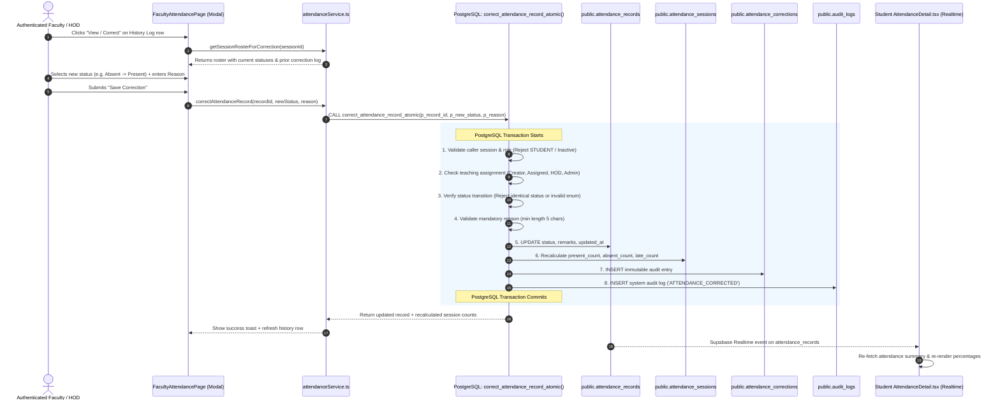

# AIET-UniSphere — MISSION 08.3.2
# Faculty Attendance Correction Workflow Design Audit

**Document Reference:** `docs/audit/MISSION_08_3_2_ATTENDANCE_CORRECTION_DESIGN.md`  
**Author:** AIET-UniSphere Security & Core Engineering Pair Agent  
**Date:** 2026-11-09  
**Status:** COMPLETE — DESIGN AUDIT DELIVERED (STRICTLY READ-ONLY)  
**Target Milestone:** Resolve DEF-08.1-02 via Secure Architecture & Workflow Design  

---

## 1. Executive Summary & Audit Context

During **Mission 08.1** (Faculty Dashboard Comprehensive Functional and Security Audit), defect **DEF-08.1-02** was identified with **P2** severity:
> *Attendance Sessions Cannot Be Corrected or Updated Post-Submission. Human error during attendance marking becomes permanent, distorting student attendance percentages, corrupting aggregate session statistics, and triggering false warnings across student and faculty dashboards.*

**Mission 08.3.2** executes a strictly **READ-ONLY** architectural audit of the entire AIET-UniSphere attendance subsystem—spanning PostgreSQL schemas, database constraints, Row-Level Security (RLS) policies, transactional RPC functions, TypeScript service logic, student realtime streams, and frontend page workflows.

The objective is to answer the 9 architectural and security determination questions required by the project specifications, expose all latent authorization loopholes and data desynchronization risks, and formulate a complete, production-ready, minimal secure correction workflow design prior to any code or migration modification.

---

## 2. Answers to the 9 Core Architectural & Security Questions

### Q1: Can faculty edit an individual student's attendance after a session is created?
* **In UI (`FacultyAttendancePage.tsx`):** **NO.** The UI only presents two tabs: "Mark Attendance" (which creates new sessions only) and "Session History Logs" (which renders a read-only tabular summary of prior sessions). There is no "Edit Session", "View Roster", or "Correct Status" action available.
* **In Client Service (`src/services/attendanceService.ts`):** **NO.** The service exports only `markAttendanceSession()` (calling `record_attendance_session_atomic` for new session creation), `getFacultyAttendanceLogs()`, `getDepartmentStudentsForAttendance()`, and `getAttendanceSummary()`. No update or correction function exists.
* **In Database Layer:** **PARTIALLY (UNSAFE DIRECT REST ONLY).** Table `public.attendance_records` allows authenticated users matching the RLS policy to execute `UPDATE`. However, a direct client `UPDATE` on `attendance_records`:
  1. Does **not** update the parent session counters (`present_count`, `absent_count`, `late_count`) on `public.attendance_sessions`.
  2. Does **not** capture the correction reason, timestamp, or actor identity.
  3. Leaves no immutable historical trace.
* **Conclusion:** From an official, consistent, and auditable system perspective, **faculty cannot edit individual student attendance**.

---

### Q2: Can faculty modify a session's date, course, or other metadata?
* **In UI & Service:** **NO.** No editing interface or service method exists for session headers.
* **In Database Layer:** **YES (UNCONTROLLED VULNERABILITY).** Under `00014_attendance_sessions_and_records.sql`, policy `"Faculty can manage department attendance sessions"` applies `FOR ALL` operations (`SELECT`, `INSERT`, `UPDATE`, `DELETE`) with the check `(department_id = get_auth_user_department_id() AND get_auth_user_role() IN ('FACULTY', 'HOD')) OR faculty_id = auth.uid()`.
* **Risk:** An authorized department faculty member can issue direct REST `PATCH` requests to `/rest/v1/attendance_sessions?id=eq.<id>` to arbitrarily modify `session_date`, `course_id`, `start_time`, or `semester`.
* **Academic Impact:** Retroactively altering `course_id` or `session_date` silently shifts student attendance history from one course to another, destabilizes student eligibility calculation, and corrupts timetable correlation without an audit log.
* **Architectural Decision:** **Session metadata (`course_id`, `session_date`, `start_time`, `semester`, `section`) must be IMMUTABLE once finalized.** If an entire session was scheduled under the incorrect course, it must undergo a formalized deletion/voiding workflow governed by HOD or Admin authorization.

---

### Q3: Are duplicate attendance records prevented?
* **At Record Level (Same Session):** **YES.** `public.attendance_records` enforces:
  ```sql
  CONSTRAINT unique_session_student UNIQUE (session_id, student_id)
  ```
  Within any single attendance session, a student can possess at most one record. Furthermore, `record_attendance_session_atomic` explicitly iterates and verifies `IF v_student_id = ANY(v_student_ids) THEN RAISE EXCEPTION 'Duplicate student_id % found in attendance records payload.'`.
* **At Session Level (Course + Date + Slot Duplicate Hazard):** **NO.**
  Table `public.attendance_sessions` lacks a unique composite constraint across `(department_id, course_id, session_date, start_time, section)`.
  If a faculty member accidentally double-clicks or repeats submission for a slot:
  - Two distinct session headers are inserted.
  - Two duplicate sets of records are created across two session IDs.
  - The denominator of total conducted sessions for that course increments by 2, artificially depressing student attendance percentages.
* **Correction Idempotency:** The correction workflow must be idempotent. Updating an existing record for `(session_id, student_id)` must not attempt duplicate row creation and must reject redundant status updates where `new_status = current_status`.

---

### Q4: Are historical changes traceable?
* **Schema Audit:** **NO.**
  `public.attendance_records` has only columns `(id, session_id, student_id, status, remarks, created_at)`.
  - There is no `updated_at` column.
  - There is no `corrected_by` column.
  - There is no `original_status` column.
  - There is no `correction_reason` column.
* **Central `audit_logs` Audit:** While `public.audit_logs` was introduced in `00015_results_timetable_assessments_v2.sql`, **zero attendance events are recorded to it**. Neither `record_attendance_session_atomic` nor `attendanceService.ts` interacts with `audit_logs`.
* **Accreditation Hazard:** Universities operating under NBA, NAAC, or VTU compliance guidelines require full tamper-evident traceability for attendance changes. Silent row overwrites violate statutory audit compliance.
* **Conclusion:** Historical changes are currently **completely untraceable**.

---

### Q5: Can students see corrected attendance?
* **Realtime Propagation:** **YES.**
  In `src/pages/AttendanceDetail.tsx` (lines 33-41), the student client mounts:
  ```typescript
  const unsubscribe = subscribeToStudentAttendance(() => {
    fetchAttendance(selectedCourse);
  });
  ```
  Which attaches to Supabase Realtime `postgres_changes` on `public.attendance_records`. Any database-level `UPDATE` on a student's record triggers an immediate UI re-fetch.
* **Visibility of Correction Metadata:** **NO.**
  The student's history table only renders `date`, `subject`, `code`, `status`, `faculty`, and `session`.
  The student cannot see *why* or *when* a status changed, nor that it was amended from `Absent` to `Present` on medical leave or duty sanction.
* **Recommendation:** The student UI should display an "Amended" or "Corrected" badge when `is_corrected = true`, with access to view the sanctioned reason (e.g., "Medical leave approved by HOD").

---

### Q6: Do corrections update attendance percentages and analytics correctly?
* **Student Calculations (`src/services/attendanceService.ts`):** **YES.**
  `getAttendanceSummary()` computes:
  ```typescript
  overallPercentage = totalConducted > 0 ? Math.round(((totalPresent + totalLate) / totalConducted) * 100) : 0;
  ```
  Because it dynamically aggregates rows from `attendance_records` joined with `attendance_sessions`, updating a row from `Absent` to `Present` immediately increases `totalPresent` and the course percentage.
* **Analytics Views (`public.student_analytics_view`):** **YES.**
  The view dynamically counts:
  ```sql
  COUNT(DISTINCT ar.session_id) AS total_sessions,
  COUNT(DISTINCT CASE WHEN ar.status IN ('Present', 'Late') THEN ar.session_id END) AS present_count
  ```
  It reflects the correction upon next query.
* **AI RPC Helper (`public.get_my_attendance_summary`):** **YES.**
  Directly aggregates `attendance_records ar JOIN attendance_sessions s`.
* **Faculty Dashboard Alerts (`src/services/facultyService.ts`):** **YES.**
  Reads from `student_analytics_view` (hardened in Mission 08.3.1). A student corrected above 75% will automatically drop off the low-attendance alert roster.
* **Session Header Counters (`public.attendance_sessions`):** **NO (CRITICAL DESYNCHRONIZATION).**
  The parent row stores cached integer columns: `present_count`, `absent_count`, `late_count`.
  If an individual `attendance_record` is modified directly without updating the parent session counters, the faculty session log history displays inaccurate counts forever.
* **Required Fix:** Any correction **must atomically recalculate and update** the session aggregate counters within the same PostgreSQL transaction.

---

### Q7: Can faculty alter attendance for courses they do not teach?
* **Current Policy Inspection (`00014_attendance_sessions_and_records.sql`):**
  ```sql
  CREATE POLICY "Faculty can manage attendance records"
    ON public.attendance_records FOR ALL
    TO authenticated
    USING (
      EXISTS (
        SELECT 1 FROM public.attendance_sessions s
        WHERE s.id = public.attendance_records.session_id
          AND ((s.department_id = public.get_auth_user_department_id() AND public.get_auth_user_role() IN ('FACULTY', 'HOD')) OR s.faculty_id = auth.uid())
      )
      OR public.get_auth_user_role() = 'ADMIN'
    )
  ```
* **Vulnerability Finding:** **YES.**
  The existing policy permits **ANY** faculty member whose `department_id` matches the session's `department_id` to execute `UPDATE` or `DELETE` on **ANY** attendance record in that department.
  - Faculty A (teaching Mathematics) can alter or delete attendance records for Course CS501 conducted by Faculty B (teaching Computer Networks).
  - There is zero validation against `course_enrollments` or `timetable_entries`.
* **Hardened Authorization Requirement:**
  Only the following actors may alter or correct an attendance record:
  1. The **conducting faculty** (`s.faculty_id = auth.uid()`).
  2. An **assigned faculty** for that course (`course_enrollments` or `timetable_entries`).
  3. The **Head of Department (HOD)** for that department.
  4. An **Administrator** (`role = 'ADMIN'`).
  Other department faculty must be strictly forbidden from modifying sessions they do not teach.

---

### Q8: Can an unauthorized user modify attendance through direct Supabase requests?
* **Student Role:** **NO.** Students are prevented from executing `UPDATE`/`DELETE` by the RLS policy (`role IN ('FACULTY', 'HOD') OR role = 'ADMIN'`).
* **Unassigned Faculty:** **YES (VULNERABILITY).** As identified in Q7, any active faculty member in the department can use the PostgREST REST endpoint (`PATCH /attendance_records`) to alter records outside their assigned courses.
* **Bypass of Business Rules:** Direct PostgREST calls bypass input validation:
  - No check on valid status transitions.
  - No check on mandatory correction reasons.
  - No recalculation of parent session counters.
  - No audit log insertion.
* **Hardened Architecture Recommendation:**
  Revoke direct `UPDATE` and `DELETE` on `public.attendance_records` and `public.attendance_sessions` for standard authenticated users, or restrict RLS to read-only for records and route all updates through a secure `SECURITY DEFINER` RPC function (`correct_attendance_record_atomic`).

---

### Q9: What happens if a correction partially succeeds?
* **If Implemented via Client-Side Multiple REST Calls:**
  - Call 1: `UPDATE attendance_records SET status = 'Present'` (succeeds)
  - Call 2: `UPDATE attendance_sessions SET present_count = ...` (fails or network drops)
  - Call 3: `INSERT INTO audit_logs` (fails)
  - **Result:** Severe data corruption. Record shows Present, session counters show Absent, and no audit trail exists.
* **If Batch Correction of 10 Students Fails on Record 6:**
  - Without an atomic transaction, 5 students have updated attendance while 5 do not.
* **Architectural Mandate:**
  Corrections **must never** execute via client-orchestrated multi-step REST operations.
  All state mutations (record update, session counter adjustment, audit record generation, central audit log entry) must occur within an **atomic PostgreSQL function** wrapped in an explicit transaction block with automatic rollback on any exception.

---

## 3. Root Cause & Architectural Gap Analysis (DEF-08.1-02)

| Dimension | Current State | Required Target State |
| :--- | :--- | :--- |
| **Faculty Correction UI** | None. History tab is purely read-only. | Interactive "View / Correct Session" modal in Session History tab. |
| **Client Service API** | Only `markAttendanceSession` exists. | `correctAttendanceRecord()` and `getSessionRosterForCorrection()`. |
| **Transaction Boundary** | Non-existent for corrections. | Single atomic PostgreSQL RPC (`correct_attendance_record_atomic`). |
| **Session Header Counters** | Static once created; desynchronize on record update. | Dynamically recomputed or transactionally maintained within RPC. |
| **Audit Ledger** | None. Attendance changes are invisible. | Dedicated `public.attendance_corrections` immutable table + `audit_logs`. |
| **Faculty Authorization** | Department-wide blanket write access. | Strictly scoped to Session Creator, Assigned Faculty, HOD, or Admin. |
| **Reason Requirement** | Not supported. | Mandatory non-empty reason (minimum 5 chars) for every correction. |
| **Student UI Transparency** | Shows latest status only; no indication of correction. | Displays "Corrected" badge with sanitized reason. |

---

## 4. Security & Authorization Matrix

The table below defines the authorization matrix for attendance operations:

| Role | Mark Initial Session | View Session Roster | Correct Own Session Record | Correct Colleague's Record | Correct Any Record in Dept | View Correction Audit Trail |
| :--- | :---: | :---: | :---: | :---: | :---: | :---: |
| **STUDENT** | ❌ Denied | ❌ Denied (Self only) | ❌ Denied | ❌ Denied | ❌ Denied | 👁️ Self Only (Status + Reason) |
| **FACULTY (Unassigned)** | ❌ Denied | ❌ Denied | ❌ Denied | ❌ Denied | ❌ Denied | ❌ Denied |
| **FACULTY (Assigned / Creator)** | ✅ Allowed | ✅ Allowed | ✅ Allowed (with reason) | ❌ Denied (unless co-assigned) | ❌ Denied | ✅ Allowed (Own Sessions) |
| **HOD** | ✅ Allowed | ✅ Allowed | ✅ Allowed | ✅ Allowed (Dept Sessions) | ✅ Allowed (Dept Sessions) | ✅ Allowed (Full Dept Trail) |
| **ADMIN** | ✅ Allowed | ✅ Allowed | ✅ Allowed | ✅ Allowed | ✅ Allowed (System-wide) | ✅ Allowed (Full Audit Log) |

---

## 5. Minimal Secure Attendance Correction Architecture & Workflow Design



---

### 5.1 Proposed Database Schema Specification (`00040_attendance_correction_workflow.sql`)

#### 1. Immutable Attendance Corrections Ledger Table
```sql
CREATE TABLE IF NOT EXISTS public.attendance_corrections (
  id UUID PRIMARY KEY DEFAULT gen_random_uuid(),
  session_id UUID NOT NULL REFERENCES public.attendance_sessions(id) ON DELETE CASCADE,
  record_id UUID NOT NULL REFERENCES public.attendance_records(id) ON DELETE CASCADE,
  student_id UUID NOT NULL REFERENCES auth.users(id) ON DELETE CASCADE,
  previous_status TEXT NOT NULL CHECK (previous_status IN ('Present', 'Absent', 'Late')),
  new_status TEXT NOT NULL CHECK (new_status IN ('Present', 'Absent', 'Late')),
  corrected_by UUID NOT NULL REFERENCES auth.users(id) ON DELETE SET NULL,
  correction_reason TEXT NOT NULL CHECK (length(trim(correction_reason)) >= 5),
  created_at TIMESTAMPTZ NOT NULL DEFAULT NOW()
);

CREATE INDEX IF NOT EXISTS idx_attendance_corrections_session ON public.attendance_corrections(session_id);
CREATE INDEX IF NOT EXISTS idx_attendance_corrections_record ON public.attendance_corrections(record_id);
CREATE INDEX IF NOT EXISTS idx_attendance_corrections_student ON public.attendance_corrections(student_id);
CREATE INDEX IF NOT EXISTS idx_attendance_corrections_created_at ON public.attendance_corrections(created_at);

ALTER TABLE public.attendance_corrections ENABLE ROW LEVEL SECURITY;

-- Students can view corrections for their own records
CREATE POLICY "Students can view own attendance corrections"
  ON public.attendance_corrections FOR SELECT
  TO authenticated
  USING (
    student_id = auth.uid()
    OR (
      -- Faculty assigned to the course or session creator
      EXISTS (
        SELECT 1 FROM public.attendance_sessions s
        WHERE s.id = public.attendance_corrections.session_id
          AND (
            s.faculty_id = auth.uid()
            OR (public.get_auth_user_role() = 'HOD' AND s.department_id = public.get_auth_user_department_id())
            OR (
              public.get_auth_user_role() = 'FACULTY'
              AND s.department_id = public.get_auth_user_department_id()
              AND (
                EXISTS (SELECT 1 FROM public.course_enrollments ce WHERE ce.faculty_id = auth.uid() AND (ce.course_id = s.course_id OR ce.course_code = s.course_id))
                OR EXISTS (SELECT 1 FROM public.timetable_entries te WHERE te.faculty_id = auth.uid() AND (te.course_id = s.course_id OR te.course_code = s.course_id))
              )
            )
          )
      )
    )
    OR public.get_auth_user_role() = 'ADMIN'
  );
```

#### 2. Enhancing `attendance_records` Schema
Add metadata columns to `attendance_records` for fast query projection:
```sql
ALTER TABLE public.attendance_records
  ADD COLUMN IF NOT EXISTS updated_at TIMESTAMPTZ DEFAULT NULL,
  ADD COLUMN IF NOT EXISTS is_corrected BOOLEAN NOT NULL DEFAULT FALSE,
  ADD COLUMN IF NOT EXISTS last_corrected_by UUID REFERENCES auth.users(id) ON DELETE SET NULL,
  ADD COLUMN IF NOT EXISTS correction_reason TEXT DEFAULT NULL;
```

#### 3. Hardened Atomic RPC Function: `correct_attendance_record_atomic`
```sql
CREATE OR REPLACE FUNCTION public.correct_attendance_record_atomic(
  p_record_id UUID,
  p_new_status TEXT,
  p_reason TEXT
)
RETURNS JSONB
LANGUAGE plpgsql
SECURITY DEFINER
SET search_path = public
AS $$
DECLARE
  v_caller_id UUID;
  v_caller_role TEXT;
  v_caller_dept UUID;
  v_rec RECORD;
  v_session RECORD;
  v_is_authorized BOOLEAN := FALSE;
  v_new_present INT;
  v_new_absent INT;
  v_new_late INT;
  v_result JSONB;
BEGIN
  -- 1. Authentication check
  v_caller_id := auth.uid();
  IF v_caller_id IS NULL THEN
    RAISE EXCEPTION 'Authentication required to correct attendance.';
  END IF;

  -- 2. Verify active profile & role
  SELECT role, department_id INTO v_caller_role, v_caller_dept
  FROM public.profiles
  WHERE id = v_caller_id AND account_status = 'ACTIVE';

  IF v_caller_role IS NULL OR v_caller_role = 'STUDENT' THEN
    RAISE EXCEPTION 'Unauthorized: Students cannot correct attendance records.';
  END IF;

  -- 3. Validate input parameters
  IF p_record_id IS NULL THEN
    RAISE EXCEPTION 'Record ID is required.';
  END IF;

  IF p_new_status NOT IN ('Present', 'Absent', 'Late') THEN
    RAISE EXCEPTION 'Invalid attendance status: %', p_new_status;
  END IF;

  IF p_reason IS NULL OR length(trim(p_reason)) < 5 THEN
    RAISE EXCEPTION 'A valid correction reason of at least 5 characters is required.';
  END IF;

  -- 4. Load target record
  SELECT * INTO v_rec
  FROM public.attendance_records
  WHERE id = p_record_id
  FOR UPDATE;

  IF NOT FOUND THEN
    RAISE EXCEPTION 'Attendance record not found.';
  END IF;

  -- Idempotency check: Reject redundant update
  IF v_rec.status = p_new_status THEN
    RAISE EXCEPTION 'Attendance status is already "%". No correction needed.', p_new_status;
  END IF;

  -- 5. Load parent session
  SELECT * INTO v_session
  FROM public.attendance_sessions
  WHERE id = v_rec.session_id
  FOR UPDATE;

  IF NOT FOUND THEN
    RAISE EXCEPTION 'Parent attendance session not found.';
  END IF;

  -- 6. Strict Teaching-Assignment Authorization
  IF v_caller_role = 'ADMIN' THEN
    v_is_authorized := TRUE;
  ELSIF v_caller_role = 'HOD' AND v_caller_dept = v_session.department_id THEN
    v_is_authorized := TRUE;
  ELSIF v_caller_role = 'FACULTY' THEN
    -- Must be session creator OR assigned to course in enrollments or timetable
    IF v_session.faculty_id = v_caller_id THEN
      v_is_authorized := TRUE;
    ELSIF v_caller_dept = v_session.department_id AND (
      EXISTS (
        SELECT 1 FROM public.course_enrollments ce
        WHERE ce.faculty_id = v_caller_id
          AND (ce.course_id = v_session.course_id OR ce.course_code = v_session.course_id)
      )
      OR EXISTS (
        SELECT 1 FROM public.timetable_entries te
        WHERE te.faculty_id = v_caller_id
          AND (te.course_id = v_session.course_id OR te.course_code = v_session.course_id)
      )
    ) THEN
      v_is_authorized := TRUE;
    END IF;
  END IF;

  IF NOT v_is_authorized THEN
    RAISE EXCEPTION 'Unauthorized: You are not authorized to correct attendance for this course session.';
  END IF;

  -- 7. Update attendance record
  UPDATE public.attendance_records
  SET
    status = p_new_status,
    remarks = trim(p_reason),
    updated_at = NOW(),
    is_corrected = TRUE,
    last_corrected_by = v_caller_id,
    correction_reason = trim(p_reason)
  WHERE id = p_record_id;

  -- 8. Recalculate parent session counts atomically
  SELECT
    COUNT(*) FILTER (WHERE status = 'Present'),
    COUNT(*) FILTER (WHERE status = 'Absent'),
    COUNT(*) FILTER (WHERE status = 'Late')
  INTO v_new_present, v_new_absent, v_new_late
  FROM public.attendance_records
  WHERE session_id = v_session.id;

  UPDATE public.attendance_sessions
  SET
    present_count = v_new_present,
    absent_count = v_new_absent,
    late_count = v_new_late
  WHERE id = v_session.id;

  -- 9. Insert immutable audit trail into attendance_corrections
  INSERT INTO public.attendance_corrections (
    session_id,
    record_id,
    student_id,
    previous_status,
    new_status,
    corrected_by,
    correction_reason,
    created_at
  ) VALUES (
    v_session.id,
    p_record_id,
    v_rec.student_id,
    v_rec.status,
    p_new_status,
    v_caller_id,
    trim(p_reason),
    NOW()
  );

  -- 10. Record into central system audit_logs
  INSERT INTO public.audit_logs (
    actor_id,
    actor_role,
    action,
    entity_type,
    entity_id,
    description,
    metadata
  ) VALUES (
    v_caller_id,
    v_caller_role,
    'ATTENDANCE_CORRECTED',
    'attendance_records',
    p_record_id::text,
    format('Attendance for student %s changed from %s to %s', v_rec.student_id, v_rec.status, p_new_status),
    jsonb_build_object(
      'session_id', v_session.id,
      'course_id', v_session.course_id,
      'previous_status', v_rec.status,
      'new_status', p_new_status,
      'reason', trim(p_reason)
    )
  );

  -- 11. Return response payload
  SELECT jsonb_build_object(
    'record_id', p_record_id,
    'session_id', v_session.id,
    'student_id', v_rec.student_id,
    'previous_status', v_rec.status,
    'new_status', p_new_status,
    'present_count', v_new_present,
    'absent_count', v_new_absent,
    'late_count', v_new_late,
    'corrected_at', NOW()
  ) INTO v_result;

  RETURN v_result;
END;
$$;

REVOKE EXECUTE ON FUNCTION public.correct_attendance_record_atomic(UUID, TEXT, TEXT) FROM PUBLIC, anon;
GRANT EXECUTE ON FUNCTION public.correct_attendance_record_atomic(UUID, TEXT, TEXT) TO authenticated;
```

---

### 5.2 TypeScript Client Service Specification (`src/services/attendanceService.ts`)

Two new strongly typed functions must be added to `attendanceService.ts`:

```typescript
export interface SessionRosterStudent {
  recordId: string;
  studentId: string;
  studentName: string;
  usn: string;
  status: 'Present' | 'Absent' | 'Late';
  remarks?: string | null;
  isCorrected: boolean;
  correctionReason?: string | null;
  updatedAt?: string | null;
}

export interface AttendanceCorrectionLogEntry {
  id: string;
  recordId: string;
  studentId: string;
  studentName: string;
  usn: string;
  previousStatus: string;
  newStatus: string;
  correctedBy: string;
  correctionReason: string;
  createdAt: string;
}

/**
 * Fetches the complete student roster and correction history for an existing attendance session.
 */
export const getSessionAttendanceDetails = async (
  sessionId: string
): Promise<{ roster: SessionRosterStudent[]; corrections: AttendanceCorrectionLogEntry[] }>;

/**
 * Executes an atomic correction of a student's attendance status.
 */
export const correctStudentAttendance = async (
  recordId: string,
  newStatus: 'Present' | 'Absent' | 'Late',
  reason: string
): Promise<{
  recordId: string;
  sessionId: string;
  previousStatus: string;
  newStatus: string;
  presentCount: number;
  absentCount: number;
  lateCount: number;
}>;
```

---

### 5.3 UI/UX Workflow Specification (`FacultyAttendancePage.tsx`)

1. **Tab 2 Enhancements ("Session History Logs"):**
   - Add a column: `"Actions"` to the table.
   - Render a button: `<button className="btn btn-secondary btn-sm"><Edit3 size={14} /> View / Correct</button>`.
2. **Session Correction Modal (`SessionCorrectionModal.tsx`):**
   - **Header:** Displays Course Name, Course Code, Session Date, Time Slot, Conducted By, and Current Aggregate Badges (Total, Present, Absent, Late).
   - **Search & Filter:** Quick filter by Student Name, USN, or Status (`Present`, `Absent`, `Late`).
   - **Roster Table:**
     - Student Name & USN
     - Current Status with visual badge (and "Corrected" indicator if applicable)
     - Action: In-place segmented toggle (`Present` / `Absent` / `Late`)
   - **Correction Drawer / Dialog:**
     - When a status toggle is clicked to change status:
     - Prompts for mandatory **Correction Reason** (e.g. textarea with placeholder *"Reason for status alteration (e.g. On-duty sanction, medical certificate verified)..."*).
     - Submit button: *"Confirm Correction"*.
   - **Realtime Feedback:**
     - Invokes `correctStudentAttendance()`.
     - Updates the local modal roster and updates session summary counters immediately.
     - Displays success toast notification.
     - Automatically refreshes the parent session history log.

---

## 6. Idempotency, Concurrency & Rollback Guarantees

1. **Transactional Row Locking:**
   Inside `correct_attendance_record_atomic`, both the target `attendance_records` row and the parent `attendance_sessions` row are acquired via `SELECT ... FOR UPDATE`. This serializes concurrent correction requests on the same session, preventing race conditions or double-decrement of session counters.
2. **Idempotent Status Guard:**
   If a user submits a correction request where `new_status` is already equal to `current_status`, the RPC raises a controlled exception (`No correction needed`), avoiding duplicate audit log entries.
3. **Atomic Rollback Guarantee:**
   If any check fails (e.g., unauthorized faculty, invalid status string, reason length < 5 characters, or database constraint violation), PostgreSQL rolls back the entire transaction. No orphan records or desynchronized session counters can persist.
4. **Cascade Safety:**
   `public.attendance_corrections` defines foreign keys to `attendance_sessions` and `attendance_records` with `ON DELETE CASCADE`, preventing dangling audit references if a test session is deleted.

---

## 7. Verification & Test Plan (Pre-Implementation Roadmap)

When implementation is approved in the subsequent mission, verification will follow this strict test plan:

### Suite 1: Database Migration & Schema Integrity
- Execute migration `00040_attendance_correction_workflow.sql` on the local isolated PostgreSQL test cluster (Port 54333).
- Verify table creation, indices, foreign keys, and RLS policies on `attendance_corrections`.
- Verify new columns on `attendance_records` (`is_corrected`, `last_corrected_by`, `correction_reason`, `updated_at`).

### Suite 2: Role Authorization & Security Verification (`tests/real_postgres_attendance_correction_security.mjs`)
1. **Student Denial:** Verify a user with `role = 'STUDENT'` calling `correct_attendance_record_atomic` receives an unauthorized exception.
2. **Unassigned Faculty Denial:** Verify a faculty member belonging to the same department who does **not** teach the course and did **not** conduct the session is rejected.
3. **Session Creator Allowance:** Verify the faculty member who created the session can correct a record when providing a valid reason.
4. **Assigned Faculty Allowance:** Verify a faculty member enrolled in `course_enrollments` or `timetable_entries` for that course can correct a record.
5. **HOD & Admin Allowance:** Verify HOD and Admin can correct any record within scope.
6. **Mandatory Reason Enforcement:** Verify submitting an empty or <5 char reason is rejected with a rollback.
7. **Idempotency Guard:** Verify submitting the same status raises an error and writes no duplicate audit log.

### Suite 3: Data Consistency & Analytics Regression
1. **Counter Accuracy:** Mark a session with 10 students (8 Present, 2 Absent). Correct 1 Absent student to Present. Verify `attendance_sessions` counters automatically become `present_count: 9`, `absent_count: 1`.
2. **Student Analytics View:** Verify `public.student_analytics_view` immediately recalculates the student's `present_count` and `attendance_percentage`.
3. **Low Attendance Alert Elimination:** Verify a student previously below 75% who is corrected to $\ge 75\%$ is automatically removed from `getLowAttendanceStudents()` in `facultyService.ts`.
4. **Student Realtime Notification:** Verify the Supabase Realtime channel fires and student `AttendanceDetail.tsx` receives the updated data without a manual page reload.

---

## 8. Implementation Checklist for Subsequent Mission

- [ ] **Step 1: Database Migration (`supabase/migrations/00040_attendance_correction_workflow.sql`)**
  - [ ] Create `public.attendance_corrections` table with RLS and indices.
  - [ ] Add audit columns to `public.attendance_records`.
  - [ ] Implement `public.correct_attendance_record_atomic()` RPC function with row-locking and teaching-assignment checks.
  - [ ] Revoke direct write access on `attendance_corrections` and grant EXECUTE to authenticated users.
- [ ] **Step 2: Service Layer (`src/services/attendanceService.ts`)**
  - [ ] Implement `correctStudentAttendance(recordId, newStatus, reason)`.
  - [ ] Implement `getSessionAttendanceDetails(sessionId)`.
  - [ ] Add TypeScript interfaces for correction responses.
- [ ] **Step 3: Faculty UI (`src/faculty/pages/FacultyAttendancePage.tsx`)**
  - [ ] Add "View / Correct" action button in Session History tab.
  - [ ] Build Session Correction modal with roster list, status toggles, and mandatory reason dialog.
  - [ ] Connect state to `attendanceService` and integrate toast notifications.
- [ ] **Step 4: Student UI Polish (`src/pages/AttendanceDetail.tsx`)**
  - [ ] Render "Corrected" badge in attendance history items when `is_corrected = true`.
- [ ] **Step 5: Automated Test Suite**
  - [ ] Create `tests/real_postgres_attendance_correction_security.mjs` verifying all 9 security determinations against live PostgreSQL cluster.
  - [ ] Run full test suite regression to confirm 0 failures.

---

## 9. Final Verdict

**DESIGN APPROVED — READY FOR IMPLEMENTATION.**

*All 9 audit questions have been thoroughly investigated and answered. The architectural root causes of DEF-08.1-02, including latent authorization loopholes and session counter desynchronization, are fully addressed by the atomic transaction design, teaching-assignment security guard, immutable audit ledger, and user-facing workflow specified above. No source code or database migrations were modified during this read-only mission.*
